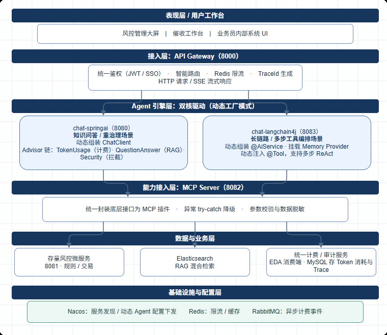

# 风控智能体中台（Risk Agent Console）

面向风控场景的 AI Agent 中台示例工程，由**后端微服务**与**前端运营控制台**两部分组成：

- 后端：Spring Boot 4.1.1 + Spring AI 2.1.0-RC1 + Spring Cloud Alibaba Nacos + LangChain4j，父工程统一管理版本，下辖 5 个可独立启动的服务。AI 服务经 Nacos 注册发现，网关作为唯一对外入口；AI 访问业务系统统一走 MCP Server 防腐层，不直连业务接口。
- 前端：Vue 3 + TypeScript + Vite 的「风控智能体中台」控制台，覆盖总览、告警、应用中心、双屏对话、智能体编排、工具与 MCP 注册、知识库、运营与合规审计，并按销售 / 管理员 / 运维主管三种角色做页面级 RBAC。

> 前端当前使用 `yp-front/src/data/console.ts` 中的模拟数据驱动，尚未接入后端真实接口；后端契约与前端路由均已就绪，可作为联调起点。

## 工程结构

```
yp/
├── readme.md
├── img.png                  # 架构图
├── yp-server/               # 后端 Maven 多模块工程（com.ggzed:yp-server）
│   ├── yp-assistant-engine/ # 问答引擎：对话 / RAG / 混合检索 / 会话记忆 / MCP Client
│   ├── yp-mock-business/    # 模拟存量业务系统，供 MCP Server 调用
│   ├── yp-agent-mcp-hub/    # MCP 工具枢纽，暴露业务工具
│   ├── yp-workflow-engine/  # 工作流引擎：LangChain4j AI Service + 本地工具
│   ├── yp-agent-gateway/    # 统一网关：Spring Cloud Gateway 统一入口
│   └── yp-agent-admin/      # 管理后台引擎：Agent 配置 / 知识库 / 计费（新增）
└── yp-front/                # 前端 Vue 3 控制台
    ├── index.html
    ├── vite.config.ts       # /api 代理到网关，@ 别名
    ├── .env.development
    └── src/
        ├── router/          # 17 个路由页面 + RBAC 守卫
        ├── data/            # 模拟数据层（console.ts）与图标库（icons.ts）
        ├── stores/          # auth / ui / platform / chat（Pinia）
        ├── styles/          # console.css，唯一设计变量来源
        ├── components/
        │   ├── layout/      # 侧边栏、顶栏
        │   ├── ui/          # 图标、页头、面板、KPI、Toast、SVG 图表
        │   └── business/    # 对话双屏、向导、风控确认、时间线、画布、瀑布图
        └── views/           # 各业务页面
```



## 后端架构

```
                 ┌───────────────────────────────────────────────────┐
   HTTP 调用      │  yp-agent-gateway :8080                           │
  ──────────────▶│  /api/chat/assistant/**  /api/chat/workflow/**    │
                 │  /api/admin/**（透传 → yp-agent-admin :8085）      │
                 └───────┬───────────────────────┬───────────────────┘
                         │ lb://yp-assistant-engine  │ lb://yp-workflow-engine
                         ▼                           ▼
              ┌──────────────────────┐   ┌──────────────────────┐
              │ yp-assistant-engine  │   │ yp-workflow-engine   │
              │ :8081                │   │ :8084                │
              │ 对话/RAG/混合检索/    │   │ LangChain4j AI       │
              │ 会话记忆/Advisor      │   │ Service + 工具        │
              └─────────┬────────────┘   └──────────────────────┘
                        │ MCP Client（按服务名从 Nacos 动态解析）
                        ▼
              ┌──────────────────────┐
              │ yp-agent-mcp-hub     │  MCP 协议 /mcp (STREAMABLE)
              │ :8083                │  工具：queryRiskLevel
              └─────────┬────────────┘
                        │ REST
                        ▼
              ┌──────────────────────┐
              │ yp-mock-business     │  GET /api/business/risk
              │ :8082                │  （模拟业务系统）
              └──────────────────────┘
```

## 模块与端口

| 模块 | 端口 | Nacos 服务名 | 包名 | 职责 |
|---|---|---|---|---|
| `yp-assistant-engine` | 8081 | `yp-assistant-engine` | `com.ggzed.springai` | 问答引擎：Spring AI 对话、RAG、混合检索、会话记忆、MCP Client |
| `yp-mock-business` | 8082 | 不注册 | `com.ggzed.business` | 模拟存量业务系统，供 MCP Server 调用 |
| `yp-agent-mcp-hub` | 8083 | `yp-agent-mcp-hub` | `com.ggzed.mcpserver` | MCP 工具枢纽（WebMVC + STREAMABLE），暴露业务工具 |
| `yp-workflow-engine` | 8084 | `yp-workflow-engine` | `com.ggzed.lc4j` | 工作流引擎：LangChain4j AI Service + 本地工具 |
| `yp-agent-gateway` | 8080 | `yp-agent-gateway` | `com.ggzed.gateway` | 统一网关：Spring Cloud Gateway 统一入口、跨域 |
| `yp-agent-admin` | 8085 | `yp-agent-admin` | `com.ggzed.admin` | 管理后台引擎：Agent 配置、知识库上传、计费查询 |
| `yp-front` | 5173 | 不注册 | — | Vue 3 控制台，`/api` 代理到网关 |

父工程坐标 `com.ggzed:yp-server`，`packaging=pom`，只做 `<modules>` 与依赖版本管理（Spring Boot / Spring AI / Spring Cloud BOM、`java.version`），子模块依赖不写版本。

## 统一的对话契约

`yp-assistant-engine` 与 `yp-workflow-engine` 使用**完全相同**的路径、入参、出参，客户端可无缝切换。

| 项 | 约定 |
|---|---|
| 非流式 | `POST /api/chat/simple` |
| 流式 | `POST /api/chat/stream`（SSE，目前仅 `yp-assistant-engine` 提供） |
| 网关闭环节 | `POST /api/chat/assistant/simple`、`POST /api/chat/workflow/simple` |
| 请求体 | `{"message": "问题内容", "sessionId": "会话 ID"}` |
| 成功响应 | `{"code": 200, "message": "操作成功", "data": {"sessionId": "...", "content": "..."}}` |
| 校验失败 | `{"code": 400, "message": "消息内容不能为空", "data": null}` |

约束：`message` 必填且 ≤4000 字符，`sessionId` 必填且 ≤64 字符。

## 接口一览

### yp-assistant-engine（8081）

| 方法 | 路径 | 说明 |
|---|---|---|
| POST | `/api/chat/simple` | 基础对话（统一契约） |
| POST | `/api/chat/stream` | 流式对话，`text/event-stream` |
| POST | `/api/rag/chat` | RAG 对话（`{query, sessionId}`） |
| POST | `/api/rag/chat_stream` | RAG 流式对话 |
| POST | `/api/search/semantic?query=` | 向量检索 |
| POST | `/api/search/hybrid` | 语义 + 关键词混合检索（RRF） |
| POST | `/api/knowledge/init` | 初始化向量库 |
| POST | `/api/knowledge/split_preview` | 文档切分预览 |
| POST | `/api/security/test` | 安全 Advisor 演示 |

### yp-workflow-engine（8084）

| 方法 | 路径 | 说明 |
|---|---|---|
| POST | `/api/chat/simple` | AI Service 对话（统一契约） |

模型为 DeepSeek 的 OpenAI 兼容接口，当前配置为非流式 `OpenAiChatModel`，因此不提供 `/stream`。

### yp-agent-mcp-hub（8083）

- 协议端点：`POST /mcp`，MCP `STREAMABLE`（JSON-RPC，非 REST）
- 工具：`queryRiskLevel(customerId)`，内部调用 `yp-mock-business` 的 `/api/business/risk`，超时与异常均做自然语言降级，不向模型抛出堆栈
- 启动即注册到 Nacos；`yp-assistant-engine` 侧不配置静态 `url`，由 `McpClientDiscoveryConfig` 按服务名解析实例

### yp-mock-business（8082）

| 方法 | 路径 | 说明 |
|---|---|---|
| GET | `/api/business/risk?customerId=` | 模拟客户风险等级查询（`VIP` 开头为低风险） |

## 前端控制台

### 技术栈

| 组件 | 选型 |
|---|---|
| 框架 | Vue 3.5（`<script setup>`）+ TypeScript |
| 构建 | Vite 6，`npm run build` 先执行 `vue-tsc --noEmit` |
| 路由 | vue-router 4，`createWebHistory` |
| 状态 | Pinia 4 |
| 样式 | `src/styles/console.css` 单一设计变量文件（工业精密风：深色底、细边框、等宽数字） |
| 图表 | 自研 SVG 组件（SparkLine / AreaChart / DonutChart / BarChart），不依赖图表库 |
| 交互 | 双屏对话、5 步向导、高危二次确认、召回阈值滑杆、链路瀑布图回放、响应式与 `prefers-reduced-motion` |

### 路由与角色

三种角色：`sales` 业务员、`admin` 管理员、`ops` 运维主管。路由 `meta.roles` 声明可访问角色，`router.beforeEach` 拦截越权访问并跳转 `/denied?from=<原路径>`。

| 路径 | 页面 | 可访问角色 |
|---|---|---|
| `/dashboard/overview` | 系统总览 | 全部 |
| `/dashboard/alerts` | 告警提示 | admin、ops |
| `/apps` | 我的 Agent | sales、admin |
| `/apps/rule-qa` | 风控规则助手（双屏对话，规则模式） | sales、admin |
| `/apps/analytics` | 风控数据智算（双屏对话，数据模式） | sales、admin |
| `/agents` | Agent 列表 | admin |
| `/agents/new` | 新建智能体（自动弹出 5 步向导） | admin |
| `/agents/flow` | 工作流编排 | admin |
| `/hub/tools` | 工具分类目录 | admin、ops |
| `/hub/servers` | MCP Server 注册 | admin、ops |
| `/hub/debug` | 接口调试 | admin |
| `/kb/docs` | 文档列表 | admin、ops |
| `/kb/recall` | 召回测试 | admin、ops |
| `/audit/billing` | Token 计费大盘 | admin、ops |
| `/audit/trace` | 全链路追踪 | admin、ops |
| `/audit/compliance` | 合规审计 | ops |
| `/denied` | 无权限提示 | 公开 |

RBAC 行为：

- 侧边栏按当前角色过滤菜单，越权项置灰锁定并提示所需角色
- 顶栏角色切换后立即复核当前路由，若失去权限则跳到 `/denied`
- `ops` 为只读视角，顶栏展示「只读模式」标签，写操作按钮在业务页内不可用
- 直接输入 URL 越权访问同样落到 `/denied`，页面展示目标路径与所需角色

### 关键交互

- **双屏对话**：左侧消息流，右侧按模式切换「RAG 引用」与「执行时间线」。回复为逐字流式模拟，切换会话或重复发送时用版本号丢弃过期片段。
- **5 步向导**：基础信息 → 模型与提示词 → 知识与记忆 → 工具挂载 → 安全与治理。资金类工具（`freeze_quota` 冻结额度、`big_debit` 大额扣款）勾选后必须通过 `DangerConfirm` 二次确认（需勾选知悉项）才能继续；发布前校验高危工具告警、敏感词等阻断项，并展示 Nacos 注册片段。
- **召回测试**：阈值滑杆实时过滤命中条数，分数低于阈值的文档不展示。
- **全链路追踪**：瀑布图点击 span 回放该段耗时与状态，与对话页执行时间线共用步骤模型。
- **响应式**：视口小于 1080px 时侧边栏转为抽屉，角色切换仅保留在抽屉内。

### 环境变量与代理

`yp-front/.env.development`：

```bash
VITE_PROXY_TARGET=http://localhost:8080   # 开发代理目标（网关）
VITE_CHAT_PREFIX=/api/chat/assistant      # 网关对外前缀（问答引擎）
```

`vite.config.ts` 将 `/api` 代理到 `VITE_PROXY_TARGET`；绕过网关直连问答引擎 8081 时，把 `VITE_PROXY_TARGET` 改为 `http://localhost:8081` 并将 `VITE_CHAT_PREFIX` 置空。

## 配置说明

公共项（各 AI 服务一致）：

```yaml
spring:
  cloud:
    nacos:
      discovery:
        server-addr: 127.0.0.1:8848
        username: nacos
        password: nacos
```

### yp-assistant-engine 关键配置

| 配置 | 值 | 说明 |
|---|---|---|
| `spring.datasource.url` | `jdbc:h2:file:./data/chat_session` | 会话持久化，首次启动自动建表 |
| `spring.elasticsearch.uris` | `http://192.168.101.100:9200` | ES 8.13 服务端 |
| `spring.ai.vectorstore.elasticsearch.index-name` | `financial_rag` | 需预先建好索引与 Mapping |
| `spring.ai.deepseek.*` | `deepseek-chat` | 对话模型，Key 取 `DEEPSEEK_API_KEY` |
| `spring.ai.openai.*` | `text-embedding-v3` | 仅用于 Embedding（DashScope 兼容端点），Chat 已禁用 |
| `spring.ai.mcp.client` | `type=SYNC`，无静态连接 | 连接由 Nacos 服务发现动态构建 |

### yp-agent-mcp-hub 关键配置

| 配置 | 值 | 说明 |
|---|---|---|
| `spring.ai.mcp.server.protocol` | `STREAMABLE` | 必须全大写，端点固定 `/mcp` |
| `spring.ai.mcp.server.name` | `financial-tools-server` | MCP 握手返回的 serverInfo |
| `spring.ai.mcp.server.type` | `async` | WebMVC 异步传输 |

### yp-agent-gateway 路由

```yaml
- id: assistant-engine-route
  uri: lb://yp-assistant-engine
  predicates: [ Path=/api/chat/assistant/** ]
  filters: [ RewritePath=/api/chat/assistant/(?<segment>.*), /api/chat/${segment} ]
- id: workflow-engine-route
  uri: lb://yp-workflow-engine
  predicates: [ Path=/api/chat/workflow/** ]
  filters: [ RewritePath=/api/chat/workflow/(?<segment>.*), /api/chat/${segment} ]
- id: agent-admin-route
  uri: lb://yp-agent-admin
  predicates: [ Path=/api/admin/** ]   # 直接透传，不剥离前缀
```

网关只做前缀剥离，问答与工作流两个服务内部路径完全一致，因此新增同类服务时只需加一条路由。

## 环境变量

| 变量 | 必填 | 用途 |
|---|---|---|
| `DEEPSEEK_API_KEY` | 是 | Spring AI / LangChain4j 对话模型 |
| `DASHSCOPE_API_KEY` | 是 | Embedding（OpenAI 兼容端点） |

## 本地启动

前置：JDK 21、Maven 3.9+、Nacos（8848）、Elasticsearch 8.13（9200）、Node.js 20+。

### 后端启动命令

```bash
cd yp-server

# 构建
mvn -T 1C clean package

# 按依赖顺序启动
mvn -pl yp-mock-business    spring-boot:run   # 8082
mvn -pl yp-agent-mcp-hub    spring-boot:run   # 8083
mvn -pl yp-assistant-engine spring-boot:run   # 8081
mvn -pl yp-workflow-engine  spring-boot:run   # 8084
mvn -pl yp-agent-admin      spring-boot:run   # 8085
mvn -pl yp-agent-gateway    spring-boot:run   # 8080
```

`yp-assistant-engine` 不强依赖 `yp-agent-mcp-hub` 的启动顺序：Nacos 查不到工具服务时只告警，工具无法调用但应用可正常启动。

### 前端启动命令

另开终端，在仓库根目录执行：

```powershell
# 进入前端目录
cd yp-front

# 首次运行或依赖变更后安装依赖
npm install

# 启动开发服务器：http://localhost:5173/dashboard/overview
npm run dev
```

其他常用命令：

```powershell
npm run dev -- --port 5174   # 5173 被占用时改端口
npm run build                # vue-tsc 类型检查 + 生产构建，产物在 dist/
npm run preview              # 本地预览构建产物
npm run lint                 # ESLint 检查
```

说明：

- 开发端口固定 5173，`/api` 按 `.env.development` 的 `VITE_PROXY_TARGET` 代理到网关 `http://localhost:8080`。
- 控制台当前由 `src/data/console.ts` 模拟数据驱动，不启动后端也能完整浏览与操作。

## 技术栈

| 组件 | 版本 |
|---|---|
| JDK | 21 |
| Spring Boot | 4.1.1 |
| Spring AI | 2.1.0-RC1 |
| Spring Cloud | 2025.1.4 |
| Spring Cloud Alibaba | 2025.1.0.0（Nacos Client 锁定 2.5.5） |
| LangChain4j | 1.23.0 |
| Elasticsearch（服务端 / 客户端） | 8.13.4 / BOM 管理 |
| Nacos | 2.5.5 |
| H2 | runtime |
| Vue / Vite / Pinia / vue-router | 3.5 / 6 / 4 / 4 |

## 设计要点

- **AI 与业务解耦**：大模型不允许直接访问业务接口，统一经 MCP Server；工具不可用时返回自然语言降级话术，避免异常暴露给模型。
- **工具动态发现**：`yp-assistant-engine` 通过 Nacos 解析 `yp-agent-mcp-hub` 实例，工具清单由 MCP 握手动态获取，不硬编码地址。
- **Advisor 责任链**：Token 用量统计、安全护栏、混合检索、会话记忆按 order 串联，记忆类 Advisor 排在检索之后。
- **会话隔离**：Session ID + JDBC（H2）持久化，重启后仍可续聊，多个会话互不串扰。
- **可解释的权限边界**：前端越权不静默跳首页，统一落到带原路径的 403 页；高危工具在向导内必须二次确认并在发布前校验阻断项。
- **单一数据源**：前端所有模拟数据集中在 `src/data/console.ts`，接入后端时只需替换该层与 `stores/chat.ts` 的发送逻辑。
